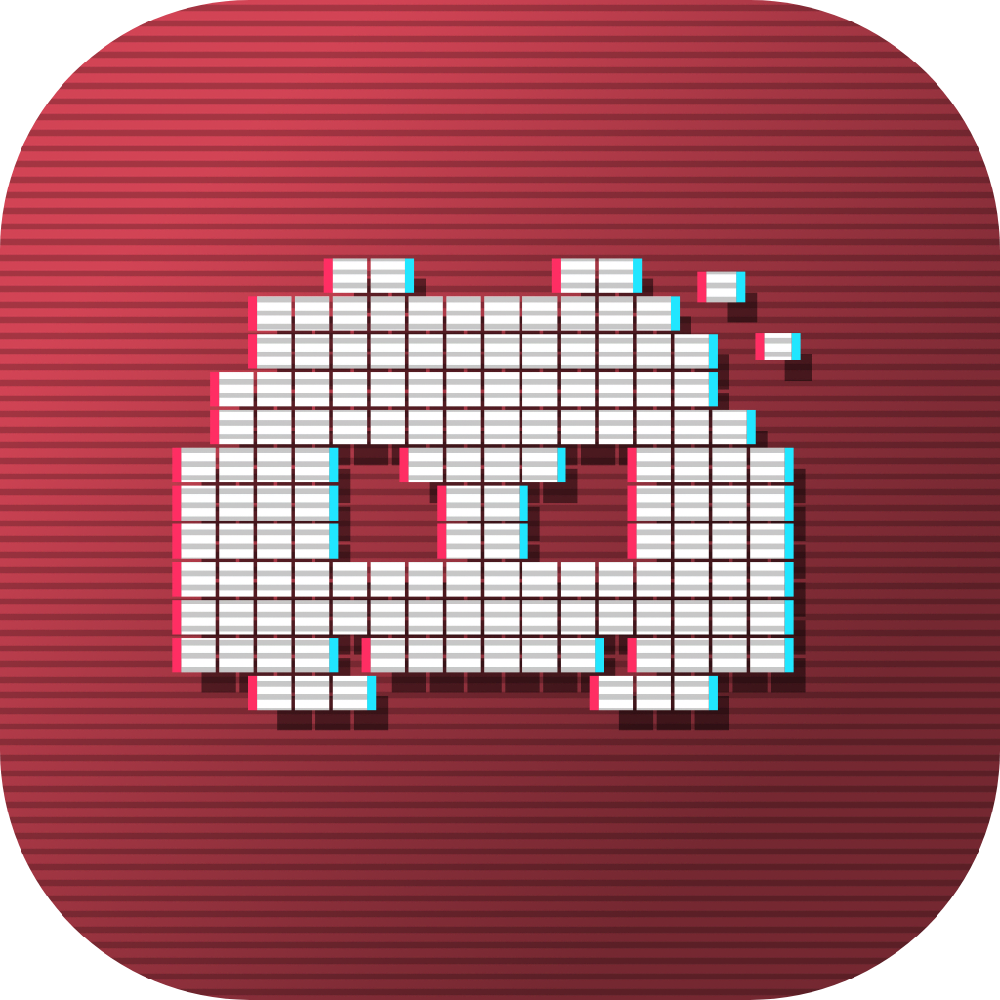
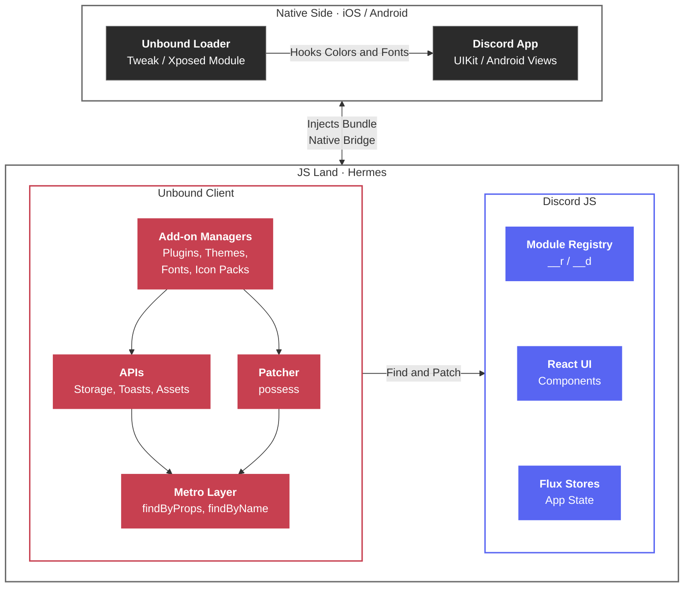

<div align="center">



<h1>Unbound</h1>

<b>A client modification for Discord on mobile.</b>

Install plugins, themes, fonts, and icon packs on the official Discord app, on both iOS and Android.

<br />

[](https://github.com/marioparaschiv/unbound/stargazers)
[](https://github.com/marioparaschiv/unbound/releases)
[](https://discord.gg/unbound)
[](./LICENSE)

**[Documentation](https://docs.unbound.rip)** · [Install](https://docs.unbound.rip/user-guide/installing) · [Discord](https://discord.gg/unbound)

</div>

<!-- TODO: add a hero screenshot or demo GIF of Unbound running here (drop assets into ./assets and reference them). -->

## Contents

- **For Users:** [What Is Unbound?](#what-is-unbound) · [Features](#features) · [Installation](#installation)
- **For Developers:** [Creating Add-ons](#creating-add-ons) · [Developing Unbound](#developing-unbound) · [Architecture](#architecture)
- **Project:** [Contributing](#contributing) · [Acknowledgements](#acknowledgements) · [Star History](#star-history) · [License](#license)

## For Users

### What Is Unbound?

Unbound is a client modification for the official Discord mobile app. It runs inside Discord and exposes a stable API for add-ons, so plugins, themes, fonts, and icon packs can be installed without patching Discord manually.

Add-ons have direct access to the modules, state, and UI that Discord itself uses. They can patch both Discord's behavior and its React components. Every change is reversible: disabling an add-on returns Discord to its stock state.

Unbound runs on iOS and Android through a single native bridge. iOS is the primary platform, and Android support is at an early stage.

This repository contains the client, the plugins and the native loaders that install Unbound on a device. The loaders live in [`packages/loader`](packages/loader): a shared C++ core, the iOS tweak and the Android Xposed module, built and released by the `loader-*` workflows.

### Features

| Feature         | Description                                                             |
| --------------- | ----------------------------------------------------------------------- |
| Add-ons         | Plugins, themes, fonts, and icon packs for the stock Discord app.       |
| Hot reloading   | Add-ons update at runtime without restarting Discord.                   |
| Error isolation | A failing add-on is caught and recorded instead of crashing the app.    |
| Recovery mode   | Returns Discord to a working state when an add-on or bundle breaks it.  |
| Cross-platform  | iOS and Android share one native bridge and behave the same way.        |
| Typed SDK       | `@unbound-app/api` provides type definitions for the entire client API. |

### Installation

Follow the [installation guide](https://docs.unbound.rip/user-guide/installing) for your platform:

| Platform                | Method                                                                      |
| ----------------------- | --------------------------------------------------------------------------- |
| iOS without a jailbreak | Sideload with SideStore, Feather, or AltStore, or install the `.ipa` file.  |
| iOS with a jailbreak    | Install from the `repo.unbound.rip` package repository.                     |
| Android                 | Xposed module. Support is early, and no official download is available yet. |

For problems after installation, see [Troubleshooting](https://docs.unbound.rip/user-guide/troubleshooting).

## For Developers

### Creating Add-ons

1. Create a project with the CLI:

    ```bash
    bunx @unbound-app/cli create
    ```

2. Set the add-on `type` in its [manifest](https://docs.unbound.rip/addons/manifest):

    | Type      | Purpose                                                                                                |
    | --------- | ------------------------------------------------------------------------------------------------------ |
    | Plugin    | Changes Discord's behavior through UI and patches. The client runs its `start()` / `stop()` lifecycle. |
    | Theme     | Overrides colors and can set a custom background.                                                      |
    | Font      | Registers custom font families natively.                                                               |
    | Icon pack | Replaces Discord's built-in assets.                                                                    |

3. Build against [`@unbound-app/api`](packages/api) for typed access to `metro`, `storage`, `toasts`, and the rest of the client API.

The [add-on documentation](https://docs.unbound.rip/addons/introduction) covers the manifest, the lifecycle, the SDK, and publishing.

### Developing Unbound

Requirements: [Bun](https://bun.sh) and a device or emulator with Unbound installed.

1. Clone the repository and install the dependencies:

    ```bash
    git clone https://github.com/marioparaschiv/unbound
    cd unbound
    bun install
    ```

2. Start the development server. It rebuilds the bundle on every change and serves it on the local network (port `3000` by default, configurable with `PORT`):

    ```bash
    bun run --filter @unbound-app/client dev
    ```

3. Set your Unbound installation's bundle URL to the printed LAN address, then restart Discord. See [Local Builds](https://docs.unbound.rip/development/local-builds) for the exact steps.

To build once without watching for changes, run `build`, then `serve`:

```bash
bun run --filter @unbound-app/client build
bun run --filter @unbound-app/client serve
```

The [debugger](https://docs.unbound.rip/development/debugging) (`bunx @unbound-app/debugger`) evaluates code and streams logs from the device.

### Architecture

1. A platform-specific native loader patches Discord to run JavaScript, then injects the client bundle.
2. On boot, the client traps Discord's Metro registry (`__r`/`__d`) and wraps every module factory. That gives it a searchable view of Discord's internal modules.
3. Add-ons find modules through the Metro layer (`findByProps`, `findByName`, `findStore`) and patch them, both plain functions and React components, with [possess](https://www.npmjs.com/package/possess).
4. The client calls into the loader for native capabilities such as reload, the filesystem, and `evaluateBytecode`.
5. The client runs on a single `initialize` / `shutdown` lifecycle. Each manager starts its add-ons on startup and tears them down on shutdown, and settings are saved before the global is cleared.



#### Packages

The client is the runtime that ships into Discord. The remaining packages support it:

| Package                                  | What it is                                                                                       |
| ---------------------------------------- | ------------------------------------------------------------------------------------------------ |
| [`packages/client`](packages/client)     | The Unbound runtime, the bundle that ships into Discord.                                         |
| [`packages/cli`](packages/cli)           | The `ubd` CLI for scaffolding and managing add-on projects.                                      |
| [`packages/debugger`](packages/debugger) | A REPL/CLI that connects to a running client to eval code, stream logs, and push add-on bundles. |
| [`packages/api`](packages/api)           | Public type declarations that add-on developers build against.                                   |
| [`packages/logger`](packages/logger)     | A small, dependency-free scoped logger with ANSI colors.                                         |
| [`packages/utils`](packages/utils)       | Per-file utilities, each imported individually for tree-shaking.                                 |
| [`packages/types`](packages/types)       | Shared TypeScript types used across the project.                                                 |

## Project

### Contributing

Contributions are welcome. Before opening a PR:

1. Run `bun run lint` and `bun run fmt:check` from the repo root. Both are enforced in CI.
2. Confirm that the client builds.
3. Write commit messages in the [Angular convention](https://www.conventionalcommits.org/) (`feat:`, `fix:`, `docs:`, ...). A commit hook enforces this.
4. Keep the PR focused and up to date with `main`.

### Acknowledgements

Unbound wouldn't exist without the work of:

- [@acquitelol](https://github.com/acquitelol) for the bundle, the debugger, and several ideas.
- [@castdrian](https://github.com/castdrian) for the iOS loader, vbound, autosupport, the automatic decryption service, and build automation / CI pipelines.
- [@NotZoeyDev](https://github.com/NotZoeyDev) for [Enmity](https://github.com/enmity-mod), and for paving the way for client modifications on iOS and mobile in general.
- [@rushiiMachine](https://github.com/rushiiMachine) for [libunbound-android](https://github.com/unbound-app/libunbound-android).

<div align="center">

<a href="https://github.com/marioparaschiv/unbound/graphs/contributors">
	
</a>

</div>

### Star History

<div align="center">

<a href="https://star-history.com/#marioparaschiv/unbound&Date">
	
</a>

</div>

### License

Unbound is licensed under the [GNU General Public License v3.0](./LICENSE).
